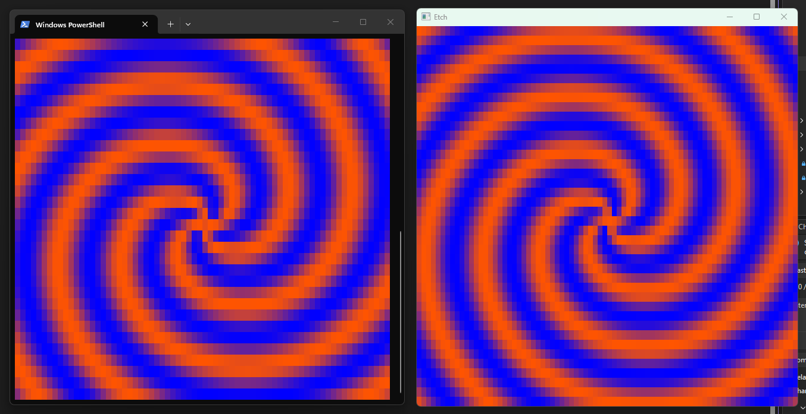

<h1 align="center">Etch</h1>

  Cell-based graphics library fully compatible with terminals and windows alike.

  
  
  
  

---

*`Spiral` painter running in both a terminal (left) and a window (right).*
